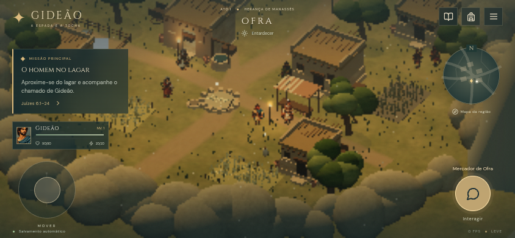

# Bible — Gideão

**A Espada e a Tocha** é uma demonstração de RPG de exploração para navegador, inspirada em Juízes 6–8 e concebida para smartphones na horizontal. Gideão caminha por cenários tridimensionais com personagens em sprites; a campanha alterna exploração, conversas, preparação do grupo, furtividade, combates por turnos e cenas na própria engine.

São quatro regiões compactas, com uma campanha de 14 objetivos. O percurso completo e a retomada offline passaram nos testes de navegador; os 40 testes unitários também passaram. O projeto busca uma sessão curta e completa; o tempo de conclusão e a meta de 30 FPS em celulares modestos ainda precisam de medição em aparelhos físicos. O [registro de validação](docs/VALIDACAO.md) distingue verificações executadas de pendências.

[**Jogar a demo e instalar a PWA**](https://kelvin-marques-cyber.github.io/Bible-Gideao/) · [Commits na main](https://github.com/Kelvin-Marques-Cyber/Bible-Gideao/commits/main/)



## Executar

Pré-requisitos: **Bun 1.4.3**, versão usada neste ambiente e nos workflows, e navegador com **WebGL2** e aceleração gráfica. O repositório é [Kelvin-Marques-Cyber/Bible-Gideao](https://github.com/Kelvin-Marques-Cyber/Bible-Gideao).

```bash
git clone https://github.com/Kelvin-Marques-Cyber/Bible-Gideao.git
cd Bible-Gideao
bun install --frozen-lockfile
bun run dev
```

Abra o endereço exibido pelo Vite, normalmente `http://localhost:5173`. O servidor aceita conexões da rede local: para experimentar os controles no celular, use o IP do computador e a porta exibida. Essa visita HTTP pela rede serve para desenvolvimento; a instalação PWA e o Service Worker exigem HTTPS ou `localhost`.

### Produção local

```bash
bun run build
bun run preview
```

O build gera `dist/`. Abra o endereço do preview, normalmente `http://localhost:4173`. O Service Worker é registrado apenas no build de produção. Abrir `index.html` diretamente pelo sistema de arquivos não equivale a servir a aplicação.

## Como jogar

Siga o objetivo à esquerda e o marcador dourado do minimapa. Aproxime-se das pessoas e dos objetos para habilitar a interação. O mercador oferece equipamentos e mantimentos; compras precisam ser equipadas no inventário. Joás e companheiros em pontos de descanso recuperam o grupo.

| Ação | Computador | Celular |
| --- | --- | --- |
| Caminhar | WASD ou setas | Arrastar o joystick à esquerda |
| Interagir | E ou Enter, perto do alvo | Botão contextual à direita |
| Avançar conversa | E, Enter ou Espaço | Botão da conversa |
| Inventário | I | Ícone da mochila |
| Diário | J | Ícone do diário |
| Referências bíblicas | B | Menu → Referências |
| Ampliar mapa | M ou clicar no mapa | Tocar no mapa |
| Pausar/opções | Esc ou menu | Ícone do menu |
| Combate | Selecionar alvo e ação com o ponteiro | Tocar no alvo e na técnica |

Em combate, velocidade determina a ordem dos turnos. Ataques precisos, observação, defesa, cobertura e comando alteram a situação tática. Defender reduz dano e recupera vigor; provisões recuperam vida. Equipamentos modificam atributos de verdade. A derrota permite reorganizar o grupo e tentar novamente, com perda de prata. Purá se junta à jornada no reconhecimento noturno.

As técnicas representam ações humanas. Não há mana, feitiços ou pontos de poder divino. Os sinais da lã, a escolha dos trezentos e o sonho são acontecimentos narrativos; o avanço não depende de charadas ou combinações.

## A campanha

| Ato | Região | Conteúdo |
| --- | --- | --- |
| I — O homem no lagar | Ofra | Opressão, chamado, aldeia, celeiro, comércio e primeiro confronto. |
| II — A noite dos altares | Colina de Ofra | Gideão com dez servos, altar de Baal, Joás, convocação e sinais da lã. |
| III — Os trezentos | Fonte de Harode | Redução de 32.000 para 10.000 e 300; preparativos e partida com Purá. |
| IV — A noite das tochas | Vale de Jezreel | Reconhecimento furtivo, sonho, três companhias, trombetas, cântaros, tochas e confronto de apoio à retirada. |

O epílogo recorda Juízes 8, incluindo a recusa da realeza e a advertência sobre o éfode. O Senhor é apresentado como o libertador; a vitória bíblica não é causada pelos atributos do jogador. O encontro tático final é uma reconstrução artística posterior à dispersão do acampamento.

As falas são paráfrases autorais em português brasileiro, conferidas na Almeida Revista e Corrigida de 2009. Moradores secundários, patrulhas, comércio, caminhos, equipamentos e confrontos de apoio são adaptações identificadas. Consulte [referências e critérios de adaptação](docs/BIBLIA.md).

## Sistemas

- Mundo Three.js com câmera de acompanhamento, colisões, personagens animados, habitantes, rondas, animais, vegetação, partículas e luzes de acordo com a região.
- Combate por turnos com alvos, vigor, moral, defesa, vulnerabilidade, apoio, provisões, recompensas e possibilidade de derrota. Invasores, lanceiros, arqueiros e capitão têm comportamentos distintos.
- Experiência, níveis, técnicas desbloqueadas, equipamentos, inventário, compra e venda, diário e atividades de apoio.
- Menus React adaptados a toque, orientação horizontal, áreas seguras, qualidade gráfica e medição de FPS da sessão.
- Música e efeitos originais sintetizados pela Web Audio API. São uma interpretação procedural, sem gravações comerciais incorporadas.
- Salvamento local, retomada da posição e progresso; manifesto de instalação e cache para uso offline após o primeiro carregamento de produção.

## Salvamento e offline

A partida guarda atributos, equipamentos, inventário, missões, região, posição, progresso e estado de batalha em **IndexedDB**. Há espelho em `localStorage`, cópia anterior e validação do formato para recuperar um registro válido quando possível. O salvamento automático acontece durante a sessão e ao ocultar a página; também existe **Menu → Salvar jornada**.

Os dados pertencem à origem do site e ao perfil do navegador. Limpar os dados do site, mudar de endereço ou usar outro dispositivo não transfere a partida. O projeto não oferece sincronização em nuvem. Restrições de armazenamento e modos privados podem impedir a persistência; a interface informa a falha.

Para jogar offline, abra o build por HTTPS e aguarde a instalação do Service Worker. O build inclui automaticamente o aplicativo, as fontes e todas as imagens no cache inicial. Uma primeira visita totalmente sem rede não pode baixar o jogo. O link para ler a Bíblia integral exige conexão. As fontes Cinzel e DM Sans são distribuídas localmente, com suas licenças em `public/fonts/`.

No Android, use a opção de instalação oferecida pelo navegador ou pelo menu quando disponível. No iPhone, use **Compartilhar → Adicionar à Tela de Início**. A disponibilidade e a aparência dessas opções dependem do navegador. A instalação real e a retomada offline em Safari/iOS permanecem pendentes de validação física.

O comando de build gera o cache completo e calcula uma identificação a partir do conteúdo dos arquivos em `scripts/build-offline.mjs`. Uma nova versão remove os caches anteriores ao ser ativada; não é necessário editar a identificação manualmente.

## Testes

```bash
bun run test
bun run typecheck
bun run build
```

Os testes de unidade cobrem dano, ordem dos turnos, inimigos, técnicas, vigor, recompensas, experiência, progressão, missões, inventário, equipamento, compra/venda e persistência. O IndexedDB é simulado com `fake-indexeddb`; isso verifica a lógica, sem substituir um teste de armazenamento no navegador.

Para os testes de navegador:

```bash
bunx playwright install chromium
bun run test:e2e
```

Em Linux de integração contínua, a instalação pode precisar de `bunx playwright install --with-deps chromium`. O workflow de validação executa unidade, build e E2E e preserva os resultados do navegador como artefato. Veja [docs/VALIDACAO.md](docs/VALIDACAO.md) para a lista de cenários efetivamente executados e as limitações. Os dois cenários passaram localmente: campanha completa (5,1 min de navegação automatizada) e toque/offline (1,3 min). Esse tempo automatizado não estima o tempo humano de leitura e exploração. Ative o rastreio opcional com `PLAYWRIGHT_TRACE=1 bun run test:e2e`.

## Publicar

O jogo é estático: publique o conteúdo de `dist/` em um servidor HTTPS. A configuração `base: './'` permite hospedagem em subdiretório, inclusive GitHub Pages. Preserve a estrutura de arquivos e sirva JavaScript, manifesto, imagens e Service Worker com os tipos adequados.

### GitHub Pages sem Actions (compilação local)

Este projeto **não** pode ser publicado diretamente a partir dos fontes da branch `main`: o `index.html` original importa `/src/main.tsx`, que precisa ser compilado pelo Vite. Isso explica a tela branca quando o GitHub Pages publica os arquivos-fonte com Jekyll. **Não escolha `main/(root)` como origem do site.**

A publicação alternativa funciona sem GitHub Actions, sem workflows de CI e sem serviços externos de build. O comando abaixo testa, compila e envia **somente o conteúdo de `dist/`** à branch `gh-pages`, preservando toda a origem e histórico de `main`:

```bash
git clone https://github.com/Kelvin-Marques-Cyber/Bible-Gideao.git
cd Bible-Gideao
bun install --frozen-lockfile
bun run deploy:pages
```

Pré-requisitos: Bun, Git e autenticação GitHub com permissão de push (Git Credential Manager, GitHub CLI ou chave SSH). Se já tiver o repositório no computador, use `git pull --ff-only origin main` antes de executar. O script cria ou atualiza `gh-pages` automaticamente por meio de um worktree temporário, **sem sobrescrever a `main`**. Inclui `.nojekyll`, ícones, manifesto, `sw.js` e recursos compilados. A cada nova versão, execute novamente `bun run deploy:pages`.

**Uma única configuração necessária no GitHub**: abra [Settings → Pages](https://github.com/Kelvin-Marques-Cyber/Bible-Gideao/settings/pages), escolha **Build and deployment → Source: Deploy from a branch**, **Branch: gh-pages**, **Folder: /(root)**, e salve. Se a branch ainda não aparecer, execute o comando local acima para criá-la primeiro. O endereço publicado é [https://kelvin-marques-cyber.github.io/Bible-Gideao/](https://kelvin-marques-cyber.github.io/Bible-Gideao/).

O GitHub ainda pode exibir um job interno chamado "pages build and deployment", mesmo com o método por branch. Isso é processamento próprio do GitHub Pages, **não exige executar nossos workflows personalizados**. A disponibilidade final depende das permissões/limitações ativas na conta; não declarar publicado até validar o URL real.

O workflow personalizado `.github/workflows/deploy.yml` foi mantido **somente para execução manual futura**, caso Actions volte a estar disponível. O mesmo vale para a validação de CI. Não é necessário executar nenhum deles para publicar por `gh-pages`.

### Outro servidor

Execute `bun run build`, envie `dist/` e configure HTTPS. Não publique `node_modules/`, arquivos de trabalho, credenciais ou configurações particulares. Teste a URL real, o carregamento de sprites e a retomada offline após o deploy. O servidor precisa entregar `sw.js` no mesmo escopo da aplicação.

## Estrutura

```text
src/
  engine/
    World.ts       cena, câmera, terreno, entidades, NPCs, rondas e cinematográficas
    art.ts         texturas e quadros procedurais
    movement.ts    deslocamento e colisões
    audio.ts       trilha e efeitos sintetizados
  game/
    types.ts       contratos dos sistemas
    state.ts       partida, inventário, comércio e missões
    battle.ts      turnos, dano, condições, IA e recompensas
    progression.ts experiência, atributos e técnicas
    items.ts       catálogo de itens e modificadores
    save.ts        IndexedDB, espelho, validação e recuperação
  content/
    campaign.ts    atos, objetivos, falas, referências e adaptações
    sprites.ts     metadados do atlas original de Gideão
    peopleSprites.ts recortes dos personagens de apoio animados
  ui/
    App.tsx        menus, HUD, controles e ligação com os sistemas
    styles.css     apresentação e adaptação às telas
public/
  assets/          retrato, atlas de animação, textura de pedra e procedência
  manifest.webmanifest
  sw.js
tests/             testes de sistemas, persistência e navegador
docs/              referências bíblicas e registro de validação
```

React controla a interface e o estado da jornada; Three.js controla a simulação visual. A lógica dos sistemas fica separada da apresentação. Câmera, terreno, NPCs, IA de patrulha e cenas ainda se concentram em `World.ts`; a organização é adequada à demonstração, e a divisão em módulos menores é uma evolução arquitetural prevista. O conteúdo está isolado para permitir outras campanhas, mas ainda não há editor nem carregador genérico de campanhas externas.

## Privacidade, recursos e limites

A aplicação não possui conta, servidor de partidas ou envio de salvamentos. Recursos de jogo e fontes são servidos pela própria hospedagem escolhida; a leitura integral da Bíblia abre um site externo. O código de depuração expõe uma ponte de leitura do estado para a verificação automatizada, sem controles para pular a campanha.

O objetivo de desempenho é 30 FPS em aparelhos modestos e até 60 FPS em aparelhos mais potentes. Há qualidade leve, limite de resolução e redução automática após amostras lentas. O número mostrado no menu mede somente a sessão atual; testes em Chromium com renderização por software não comprovam esse objetivo em um celular. Consumo de bateria, aquecimento, memória prolongada, acessibilidade completa, Safari e instalação física ainda exigem avaliação específica.

O código é licenciado sob [MIT](LICENSE). A arte original e seus prompts estão documentados em [public/assets/PROVENANCE.md](public/assets/PROVENANCE.md). As referências bíblicas externas mantêm os direitos de suas respectivas traduções. Nenhum recurso visual ou musical de jogo comercial foi copiado para este repositório.
