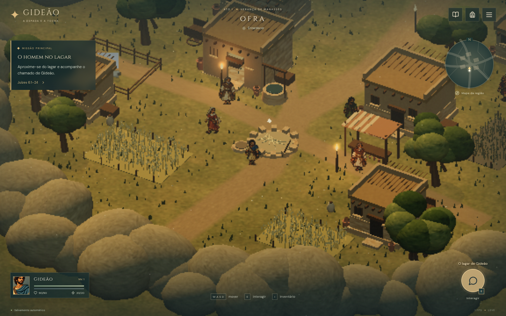
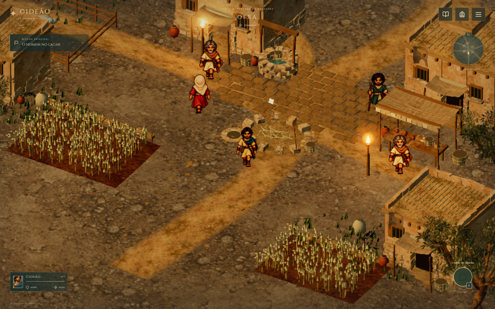

# Auditoria visual — Ofra e combate

Data: 18 de outubro de 2026. Referência anterior preservada no commit `8477b22`; as capturas antigas em `docs/screenshots/` incluem renderização por software. Elas não representam o desempenho de um celular físico.

## Referências realmente consultadas

Foram inspecionadas no navegador as capturas oficiais de [exploração junto à água](https://assets.topics.apps-jp.nintendo.com/image/2023/02/08074655491174/1280/18.jpg), [combate e Quebra](https://assets.topics.apps-jp.nintendo.com/image/2023/02/08065628962445/1280/07.jpg), [arquitetura interior](https://www.jp.square-enix.com/octopathtraveler2/assets/img/about/img03.jpg) e [acampamento noturno](https://www.jp.square-enix.com/octopathtraveler2/assets/img/about/img13.jpg). Suas páginas de origem são [Nintendo](https://www.nintendo.com/jp/topics/article/a35f3cfd-ee44-48ba-a80c-da8c4d3eeab4) e [Square Enix](https://www.jp.square-enix.com/octopathtraveler2/about/). As imagens comerciais servem à análise e não integram os recursos do jogo.

A leitura visual destaca áreas de descanso entre grupos de detalhes, materiais que continuam legíveis sem brilho, personagens nítidos na faixa de interação e planos distantes com atmosfera. Na cena noturna, pequenos focos quentes orientam o olhar; a vegetação preserva silhuetas de ramos e folhas. A arquitetura interior foi usada para observar proporções, massas secundárias e iluminação, sem transferir sua linguagem cultural para o Levante antigo.

## Diagnóstico da versão anterior

| Componente | Causa observada | Critério para a reconstrução |
| --- | --- | --- |
| `World.ts`, terreno | A praça e quase toda a vila cabem no enquadramento. O círculo de grandes rochas domina o primeiro plano. | Aproximar a escala de leitura; criar percursos enquadrados por afloramentos descontínuos, sem revelar uma borda circular. |
| `World.ts`, arquitetura | Caixas repetidas, telhados perfeitamente planos e faixas de pedra regulares. Paredes sem espessura visual e poucos volumes secundários. | Casas assimétricas com vigas, peitoris, acessos, reboco gasto, pedra exposta e conjuntos domésticos compostos. |
| `World.ts`, vegetação | Troncos retos e copas arredondadas. Grama espalhada uniformemente; trigo em retângulos rígidos. | Oliveiras com troncos e ramos visíveis; folhas recortadas, bordas agrícolas e vegetação agrupada por contexto. |
| `art.ts` | Ruído de pontos e linhas serve como acabamento de quase todos os materiais. Alterar a cor não muda sua natureza visual. | Materiais originais pintados, compartilhados e aplicados em escala coerente; procedimentos ficam como suporte, não acabamento único. |
| `sprites.ts`, `peopleSprites.ts`, `enemySprites.ts` | Grandes ilustrações recortadas mantêm a identidade, mas não equivalem a sprites desenhados numa grade pequena. Movimento reutiliza poucas poses. | Produzir quadros de pixel art com proporções consistentes e ações distintas, registrar os limites da produção e manter pés/baselines estáveis. |
| Câmera e renderização | Projeção ortográfica distante; alterar apenas o deslocamento da câmera não aproxima a imagem. DPR 0,4 reduz detalhes antes de ampliar a tela inteira. | Recalibrar campo visível e escala em conjunto; preservar resolução suficiente para materiais e sprites em todos os presets. |
| Pós-processamento | Desfoque e vinheta podem esconder as mesmas áreas que o jogador precisa ler. O caminho leve desativa todos os efeitos. | Faixa de foco útil, contraste regional moderado, brilho concentrado nas luzes e versão econômica que conserve profundidade. |
| `styles.css` | Painel permanente de objetivo, mapa e retratos grandes competem com Ofra. | Objetivo recolhível, mapa discreto, recursos compactos e dicas retiradas depois do aprendizado. |
| `BattleStage.ts`, `battle.css` | Na captura mobile inicial, os três inimigos e seus alvos se sobrepõem; o painel de ação cobre os escudos. | Espaçamento de formação verificável por toque e controles abaixo da faixa ocupada pelos personagens. |

## Comparação controlada

O baseline foi preservado em uma cópia separada do código anterior. As comparações usam partidas válidas, sem diálogo nem menu, nas posições `(0, 6)` e `(-5, 1)`, com viewports de 1440 × 900 e 844 × 390. A posição do personagem, região, estágio e condições de iluminação são mantidos; a mudança de câmera faz parte da intervenção e será registrada. Metadados de renderização acompanham as capturas.

Este documento registra critérios e evidências. A presença de sombras, bloom, texturas ou testes aprovados não certifica qualidade artística.

## Resultado inspecionado

As oito imagens abaixo foram abertas e inspecionadas. A referência usa `8477b22`; a reconstrução de ambiente está em `27414dc`, após os materiais `3d08cf8` e os NPCs `9fda973`. As capturas finais foram realizadas durante a integração com `cd60e57`, cujas alterações adicionais são de combate. O campo `source` dos JSONs finais identifica essa sessão como `9fda973-plus-environment-integration`. A renderização usa Chromium/SwiftShader, preset leve e densidade do dispositivo 1. O processo aguardou os materiais, as quatro folhas de habitantes e a estabilização da câmera.

| Posição e tela | Antes | Depois |
| --- | --- | --- |
| Praça `(0, 6)`, 1440 × 900 | [Imagem](screenshots/visual-review/before-plaza-1440x900.png) | [Imagem](screenshots/visual-review/after-plaza-1440x900.png) |
| Joás `(-5, 1)`, 1440 × 900 | [Imagem](screenshots/visual-review/before-joas-1440x900.png) | [Imagem](screenshots/visual-review/after-joas-1440x900.png) |
| Praça `(0, 6)`, 844 × 390 | [Imagem](screenshots/visual-review/before-plaza-844x390.png) | [Imagem](screenshots/visual-review/after-plaza-844x390.png) |
| Joás `(-5, 1)`, 844 × 390 | [Imagem](screenshots/visual-review/before-joas-844x390.png) | [Imagem](screenshots/visual-review/after-joas-844x390.png) |

O enquadramento mais próximo torna os rostos, os acessos e os objetos domésticos legíveis. O anel de pedras arredondadas deixa de ocupar a faixa inferior. Casas apresentam espessura de peitoris, anexos, vigas salientes, reboco irregular e cantaria exposta. O poço, a praça de lajes e os caminhos agora formam espaços distintos. Oliveiras mostram troncos bifurcados e folhas recortadas; a folha original substitui as antigas copas esféricas.

Na inspeção intermediária, o chão tinha pedras grandes e contraste excessivo. O ajuste final reduziu contraste/saturação da terra e diminuiu a escala dos seixos; os canteiros mantêm o solo mais escuro. As quatro figuras de apoio agora compartilham proporções e contorno com Gideão, com costas e perfis próprios. A missão permanece legível no painel recolhido, enquanto o mapa e os recursos ocupam menos área.

Os JSONs finais registram DPR 0,65, contra 0,4 no baseline. A nova projeção calcula aproximadamente 122 pixels CSS para a altura do herói no desktop e 57 no celular. São valores da projeção; não medem o contorno opaco de cada pose. Os testes de contexto, toque e campanha estão registrados separadamente em [VALIDACAO.md](VALIDACAO.md).

O custo visual aumentou: na praça desktop, 98 chamadas e 63.282 triângulos antes, 208 chamadas e 99.763 triângulos depois, somando os passes. A comparação não comprova otimização nem FPS em hardware móvel. Ambas as capturas desse par usaram o caminho leve, permitindo comparar essa contagem; capturas antigas que contavam apenas o último passe não servem a essa comparação.

## Produção que permanece necessária

Ofra é a região com composição de terreno mais trabalhada. Casas, oliveiras, cerâmica, tecidos e tendas compartilham os novos módulos nas outras regiões e nas arenas, mas esses lugares mantêm sua composição de terreno anterior e precisam de revisão artística própria.

A direção se aproxima da leitura de diorama e do combate da referência; ainda não equivale ao acabamento comercial de Octopath Traveler. Os sprites gerados têm recortes e pés normalizados, mas pedem revisão manual de pixels, paleta e continuidade de silhueta. Gideão possui 32 quadros de caminhada e 36 de ações; os habitantes possuem quatro quadros por direção, com respiração e deslocamentos complementares por transformação. Conversa, emoção e ataques próprios para cada NPC ainda precisam de produção de arte.

Persistem pontos de acabamento: repetição de materiais no solo, campos com contornos bastante regulares, variação limitada de habitantes, transições agrícolas e riqueza dos planos distantes. Há sombras de contato, brilho de luzes e foco protegido, com aproximações econômicas no celular. Não há SSAO/GTAO nem luz volumétrica. FPS, memória, aquecimento, bateria e instalação em Android/iOS físicos continuam sem medição.

As capturas são reproduzíveis com `scripts/capture-visuals.ts`, usando `VISUAL_ROOT`, `VISUAL_URL` e `VISUAL_SOURCE` para apontar a cópia desejada. Os JSONs ao lado de cada PNG guardam posição, câmera, qualidade, renderizador e erros.
